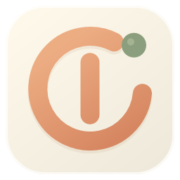
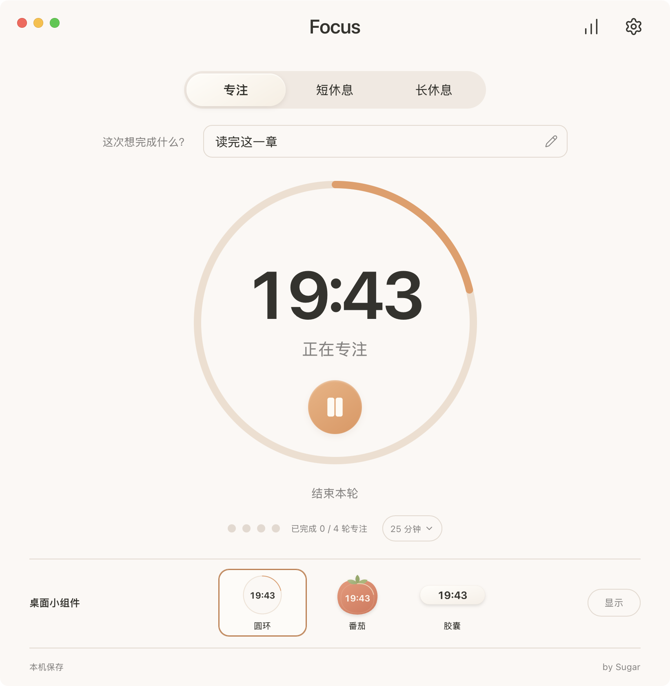
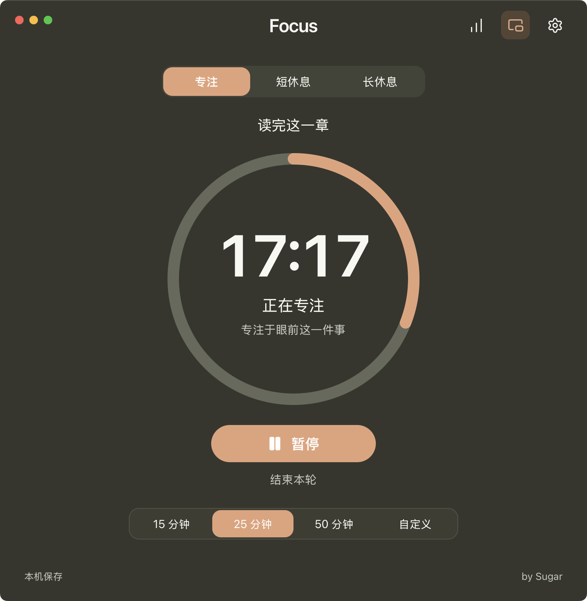
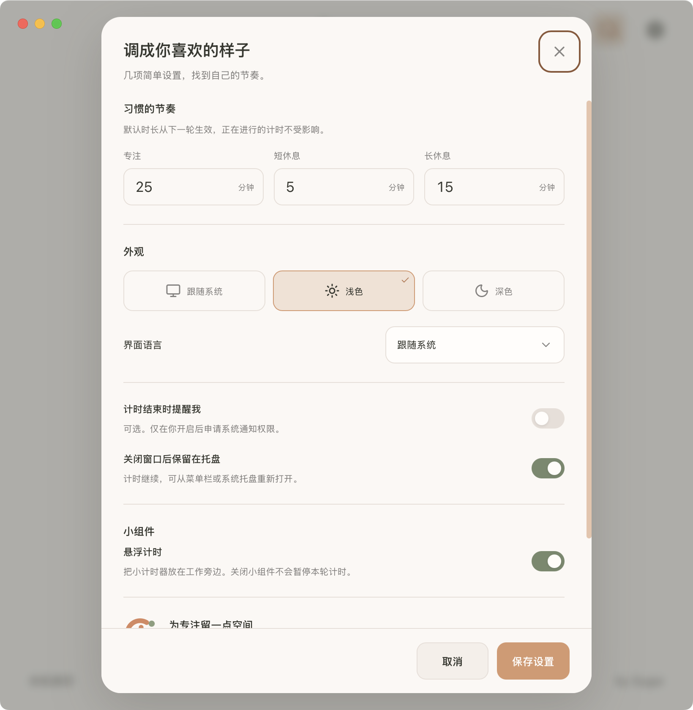
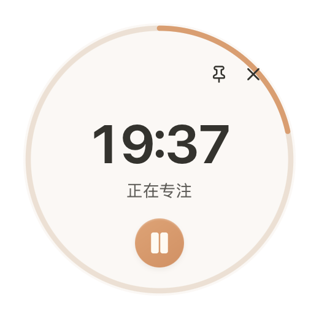
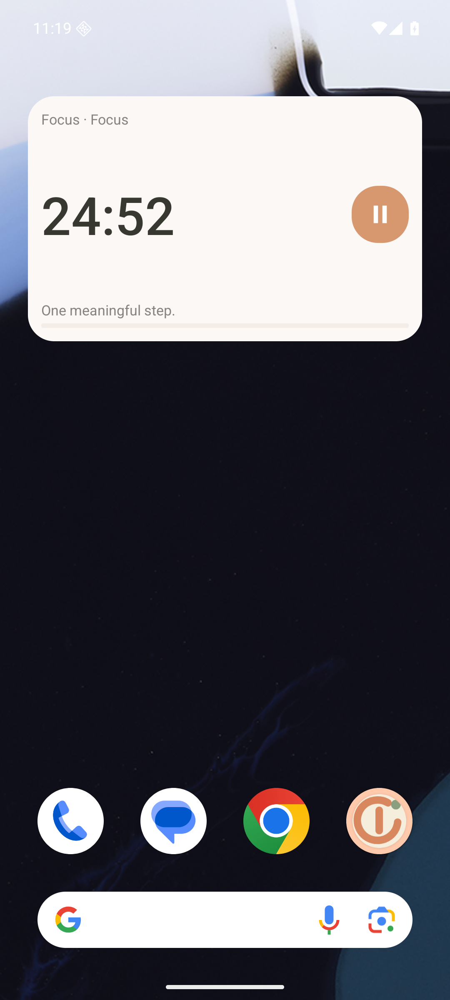

<h1 align="center">Focus by Sugar</h1>

<strong>Make room for one thing.</strong> A quiet focus timer for your desktop and Android, with warm colors and a rhythm you choose.

English · <a href="README.zh-CN.md">简体中文</a> · <a href="docs/README.zh-TW.md">繁體中文</a> · <a href="docs/README.ja.md">日本語</a> · <a href="docs/README.ko.md">한국어</a>

<a href="https://github.com/makersns/focus-timer/releases/latest">Download</a> · <a href="https://sugar.makersns.com/projects/focus">Project page</a> · <a href="https://github.com/makersns/focus-timer/issues">Feedback</a> · <a href="https://sugar.makersns.com">About Sugar</a>

  

## A little less to manage

Choose what you want to work on, pick a duration, and begin. Focus keeps the main screen simple: one timer, one intention, and one clear next action. Breaks are a deliberate choice; the app never starts another round for you.

- **Your rhythm.** Focus, short break, and long break, with 25/5/15-minute defaults and custom durations from 1 to 180 minutes.
- **Time at a glance.** A live macOS menu-bar countdown and a draggable, pinnable desktop mini timer keep your remaining time visible while you work.
- **A real Android widget.** Add Focus to your home screen, then start, pause, or resume without opening the full app. The widget and the app share the same native timer.
- **Considerate recovery.** Quitting on desktop pauses and saves. Android can recover an active round after same-boot process reclamation; reboot recovery is paused.
- **Honest records.** Completed sessions and early-ended focus time are shown separately. Recent sessions and daily totals stay on your device.
- **Make it yours.** Light, dark, or system appearance; Simplified Chinese, Traditional Chinese, English, Japanese, and Korean.
- **Quiet by default.** No account, ads, analytics, or automatic next round. Completion notifications are optional.
- **Comfortable controls.** Keyboard support, labeled controls, reduced-motion support, and a layout that adapts to smaller windows.

<table><tr><td></td><td></td></tr></table>

## The timer stays where you need it

| Platform | Small, useful surfaces |
| --- | --- |
| macOS | Remaining time directly in the menu bar, a compact control panel, and a floating mini timer |
| Windows | System-tray controls and a draggable mini timer with optional always-on-top |
| Android | A native home-screen AppWidget with countdown and pause/resume controls |
| Linux | Floating mini timer and system tray where supported by the desktop environment |

The macOS and Windows components are lightweight floating windows. The Android component is a system launcher widget. Hiding a desktop component leaves the timer running; showing it again displays the same round. Timer updates never bring a window to the front.

| Desktop component | Android home-screen widget |
| --- | --- |
|  |  |

## Download

Get installers and SHA-256 checksums from [GitHub Releases](https://github.com/makersns/focus-timer/releases/latest).

| Platform | Package |
| --- | --- |
| macOS · Apple Silicon and Intel | Universal .dmg |
| Windows · x64 | .exe installer |
| Linux · x64 | .AppImage, .deb, or .rpm |
| Android · arm64 | Signed .apk |

The first release is not Apple-notarized or signed with a Windows publisher certificate. Your operating system may show an unrecognized-developer notice. Download only from this repository's Releases page and compare the supplied checksum. Linux tray availability depends on your desktop environment.

## How time is counted

The Rust timer is authoritative. The interface renders snapshots; throttled browser rendering does not make a packaged app lose seconds. A delayed wake-up completes at most the current round. Pausing excludes the paused interval, and moving the system clock backwards never increases the remaining time.

A completed focus session increments the completed count. Ending early saves the focus time already spent without calling it a completed session. Breaks do not add focus minutes. The app keeps the latest 500 session records and up to 366 dates of daily totals. “Clear records” removes the saved history and totals without stopping a running timer.

On desktop, Focus saves explicit actions and active checkpoints up to 30 seconds apart. After an unexpected process or system failure, the saved remainder is restored as paused; progress since the last checkpoint may be lost.

On Android, a running timer uses the system's foreground-service and exact-alarm facilities. The home-screen clock uses Android's Chronometer. A single atomic state contains timer and boot/elapsed-time information, so an ordinary same-boot process restart can reconcile the current round without creating a second timer. Reboot or unverifiable recovery restores a paused round. On Android versions that require precise-timing access, the app provides the relevant system-settings action. See [Android build and behavior notes](docs/ANDROID.md).

## Build locally

Install Node.js 24+, Rust, and the [Tauri 2 platform prerequisites](https://v2.tauri.app/start/prerequisites/).

~~~bash
git clone https://github.com/makersns/focus-timer.git
cd focus-timer
npm ci
npm run tauri -- dev
~~~

For a browser-only UI preview:

~~~bash
npm run dev
~~~

Open http://127.0.0.1:1420. The preview has separate browser storage. Menu-bar controls, native windows, Android widgets and system notifications belong to the installed application.

~~~bash
npm test
npm run build
cargo test --locked --manifest-path src-tauri/Cargo.toml
npm run tauri -- build
~~~

On macOS, a universal build also needs both Rust targets:

~~~bash
rustup target add aarch64-apple-darwin x86_64-apple-darwin
npm run tauri -- build --target universal-apple-darwin
~~~

For Android, configure the official SDK, NDK and JDK prerequisites, then use the checked-in Android project:

~~~bash
npm run tauri -- android dev
~~~

See [Android development and signing](docs/ANDROID.md) for release APK instructions. Do not regenerate the native project over its maintained widget/service sources.

CARGO_TARGET_DIR can point to a separate build disk. On macOS, use APFS rather than exFAT for Rust build output. See [Contributing](CONTRIBUTING.md) for the architecture, test expectations, and translation workflow.

## Built with

[Tauri 2](https://v2.tauri.app/), Rust, React, TypeScript, and Vite. Interface symbols use [Lucide](https://lucide.dev/) under its ISC license. The app icon is an original vector design included in this repository.

## An independent project

Made by [Sugar](https://sugar.makersns.com). Focus began as a small portfolio experiment and grew into an app you can use, inspect, and improve.

If it earns a place in your day, a star helps other people find it. Bug reports, thoughtful suggestions, and translation improvements are welcome.

[MIT license](LICENSE) · [Release notes](CHANGELOG.md)
