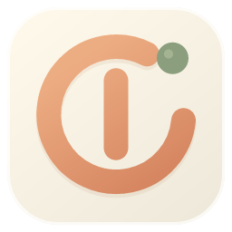
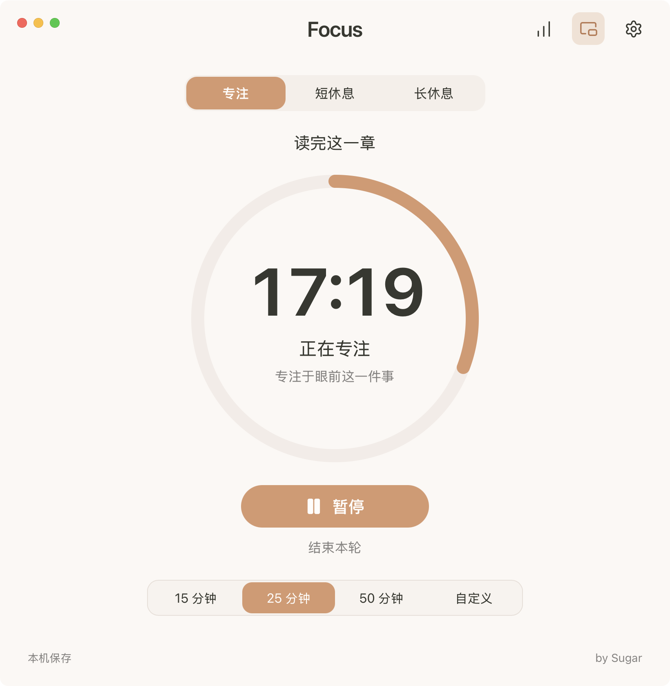
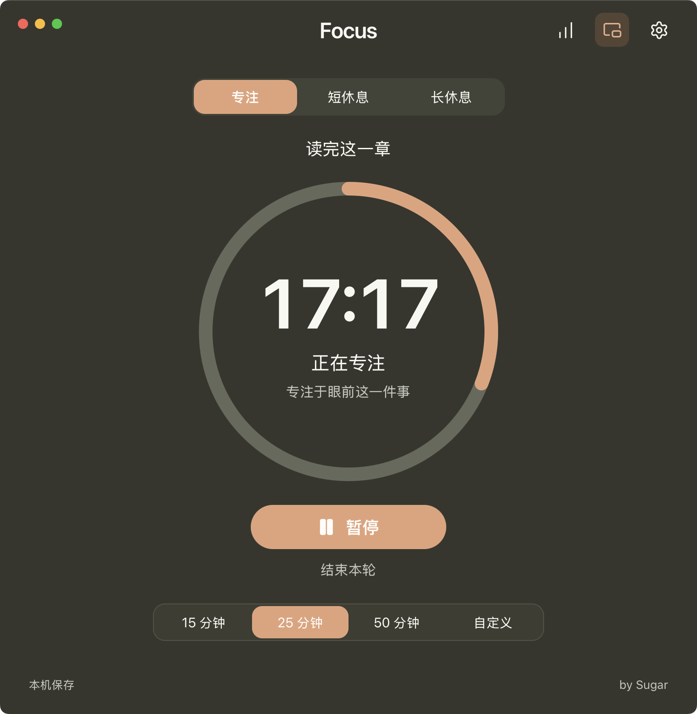
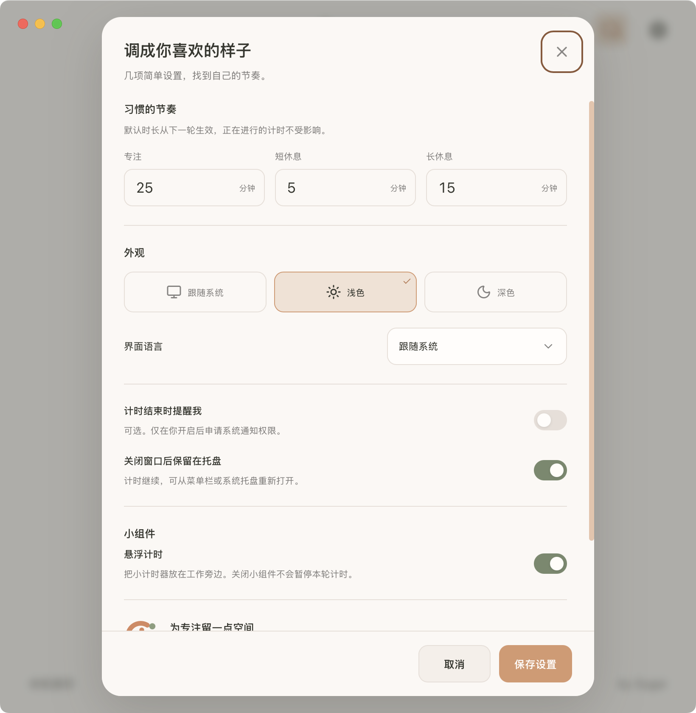
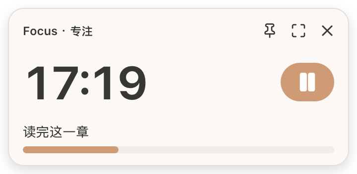
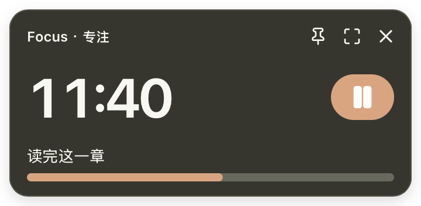
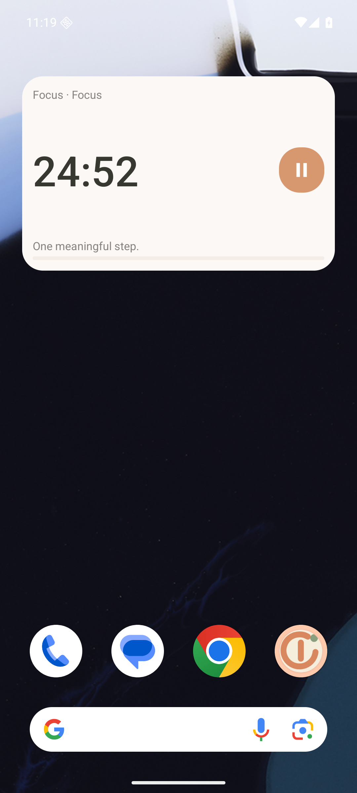

<h1 align="center">Focus · 专注计时</h1>

<strong>留一点时间，只做好一件事。</strong> 由 Sugar 制作，支持桌面和 Android 的专注应用。

<a href="README.md">English</a> · 简体中文 · <a href="docs/README.zh-TW.md">繁體中文</a> · <a href="docs/README.ja.md">日本語</a> · <a href="docs/README.ko.md">한국어</a>

<a href="https://github.com/makersns/focus-timer/releases/latest">下载客户端</a> · <a href="https://sugar.makersns.com/projects/focus?lang=zh-CN">作品介绍</a> · <a href="https://github.com/makersns/focus-timer/issues">反馈问题</a> · <a href="https://sugar.makersns.com">作者主页</a>

## 从一件小事开始

写下这次想完成的事，选择一段时间，然后开始。主界面只保留计时、一个可选的小目标，以及清楚的开始或暂停按钮。完成后是否休息、何时开始下一轮，都由你决定。

- **适合自己的节奏**：专注、短休息、长休息，默认 25 / 5 / 15 分钟；支持 1–180 分钟的自定义时长。
- **不用一直打开主窗口**：macOS 菜单栏直接显示动态倒计时；桌面悬浮小组件可拖动、可置顶，随时查看进度。
- **真正的 Android 桌面组件**：添加到手机主屏幕，直接开始、暂停或继续，与应用共用同一个计时状态。
- **符合平台的恢复方式**：桌面端退出时暂停保存；Android 同次开机内被系统回收后可恢复当前计时，设备重启后恢复为暂停。
- **真实的记录**：完整完成的轮次与提前结束的专注时间分开记录，休息时间不计入专注。
- **五种界面语言**：简体中文、繁體中文、English、日本語、한국어；支持浅色、深色和跟随系统。
- **默认安静**：无需账号，没有广告和统计追踪，不自动开始下一轮；完成通知按需开启。
- **顺手的操作**：空格键控制计时，清楚的按钮文字，减少动态效果支持，以及适应小窗口的布局。

| 深色外观 | 偏好设置 |
| --- | --- |
|  |  |

## 把计时放在顺手的位置

| 平台 | 提供的组件 |
| --- | --- |
| macOS | 菜单栏实时剩余时间、快捷控制面板、桌面悬浮小组件 |
| Windows | 系统托盘控制、可拖动和置顶的悬浮小组件 |
| Android | 真正的主屏幕 AppWidget，支持倒计时及暂停、继续 |
| Linux | 悬浮小组件；系统托盘取决于桌面环境 |

macOS 和 Windows 的组件是轻量悬浮窗口，Android 使用系统桌面组件。关闭悬浮窗只会隐藏组件；再次打开仍是同一轮计时。每秒更新时间不会把窗口突然顶到其他应用前面。

| 桌面悬浮组件 | Android 主屏幕组件 |
| --- | --- |
|    |  |

## 下载与安装

前往 [GitHub Releases](https://github.com/makersns/focus-timer/releases/latest) 下载客户端与 SHA-256 校验文件。

| 系统 | 安装包 |
| --- | --- |
| macOS · Apple Silicon / Intel | 通用 .dmg |
| Windows · x64 | .exe 安装程序 |
| Linux · x64 | .AppImage / .deb / .rpm |
| Android · arm64 | 已签名 .apk |

首版尚未进行 Apple 公证，也未配置 Windows 发布者签名，系统可能显示开发者未识别提示。请从本仓库的 Releases 页面下载并核对校验值。Linux 托盘是否显示取决于桌面环境。

## 计时和数据

客户端由 Rust 负责计时，界面只显示状态。窗口隐藏或界面刷新不会重置正在进行的计时；电脑休眠后最多完成当前一轮，不会凭空补出多轮记录。暂停期间不计时，系统时间回拨不会增加剩余时长。

完整完成一轮才增加完成数。提前结束会保存已经投入的专注时间，并标记为“提前结束”。最多保留最近 500 条记录及 366 个日期的每日汇总。“清空记录”会移除历史与汇总，当前计时继续运行。

桌面端的重要操作会立即保存，运行中最长每 30 秒保存一次检查点。意外退出时可能丢失上一个检查点之后的进度，重新打开会以暂停状态恢复。

Android 运行中的计时使用系统前台服务和到期闹钟，组件秒数由系统 Chronometer 显示。同次开机内，进程被回收后可根据同一份原子保存的状态恢复；设备重启或无法核对恢复信息时暂停。需要准确计时授权的系统版本会提供清楚的设置入口。具体构建及行为说明见 [Android 文档](docs/ANDROID.md)。

所有记录保存在本机，无需登录，也不会上传到服务器。

## 本地开发

先安装 Node.js 24+、Rust，以及 [Tauri 2 对应平台依赖](https://v2.tauri.app/start/prerequisites/)。

~~~bash
git clone https://github.com/makersns/focus-timer.git
cd focus-timer
npm ci
npm run tauri -- dev
~~~

仅预览界面可运行 npm run dev，访问 http://127.0.0.1:1420。浏览器预览使用独立存储。菜单栏、原生悬浮窗、Android 桌面组件和系统通知需要安装客户端。

~~~bash
npm test
npm run build
cargo test --locked --manifest-path src-tauri/Cargo.toml
npm run tauri -- build
~~~

macOS 通用包需要先安装两种架构的 Rust target：

~~~bash
rustup target add aarch64-apple-darwin x86_64-apple-darwin
npm run tauri -- build --target universal-apple-darwin
~~~

Android 需配置官方 SDK、NDK 和 JDK，使用仓库中已维护的原生项目：

~~~bash
npm run tauri -- android dev
~~~

APK 构建与签名见 [Android 开发说明](docs/ANDROID.md)，不要重新初始化并覆盖已维护的小组件和服务源码。

可以通过 CARGO_TARGET_DIR 把 Rust 构建缓存放到其他磁盘。macOS 构建目录请使用 APFS 文件系统。架构、测试和翻译说明见 [贡献指南](CONTRIBUTING.md)。

## 关于这个作品

Focus 使用 Tauri 2、Rust、React、TypeScript 和 Vite 开发。界面图标来自采用 ISC 许可的 [Lucide](https://lucide.dev/)，应用图标为仓库内原创矢量设计。

作者：[Sugar](https://sugar.makersns.com)。这个项目从个人网站中的一个小实验开始，现在成为可以安装、修改、共同完善的独立应用。

如果它对你有帮助，欢迎点一个 Star，让更多人找到它。也欢迎提交问题、建议和翻译改进。

[MIT 开源许可](LICENSE) · [版本记录](CHANGELOG.md)
