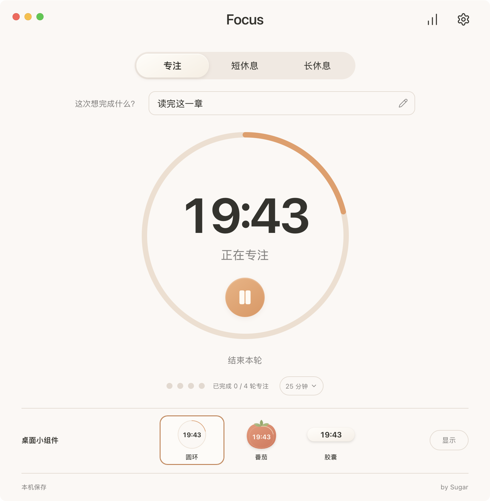
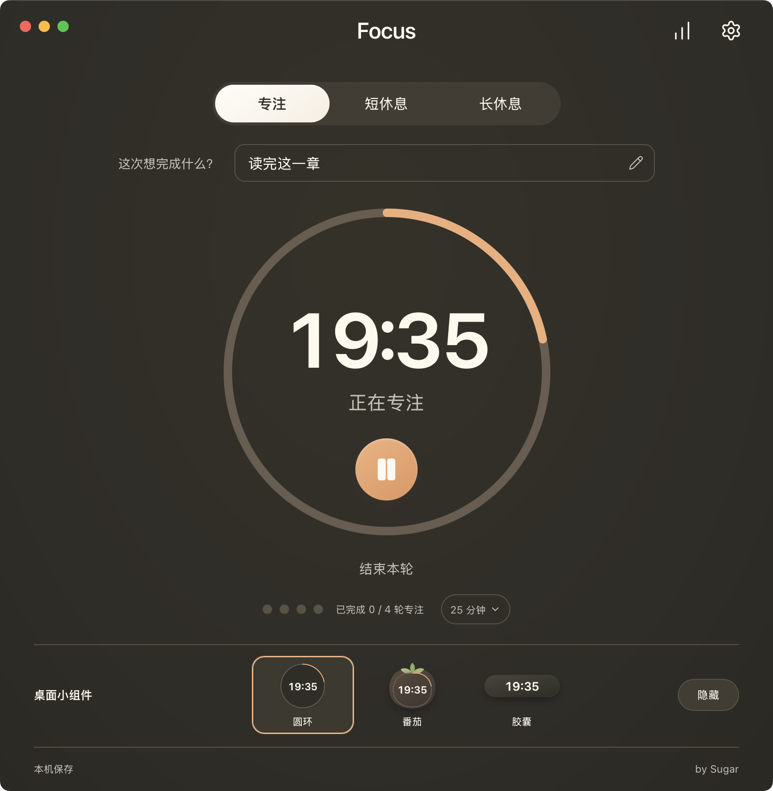
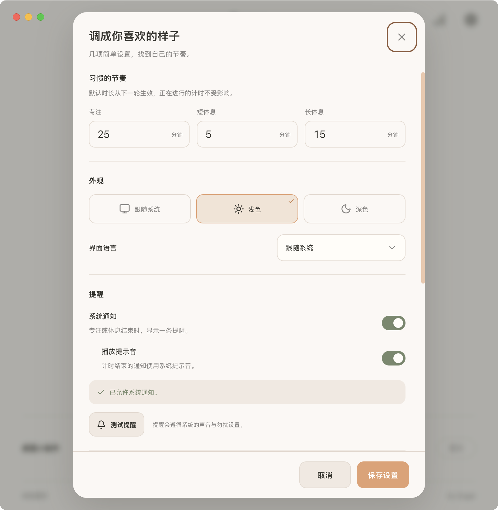
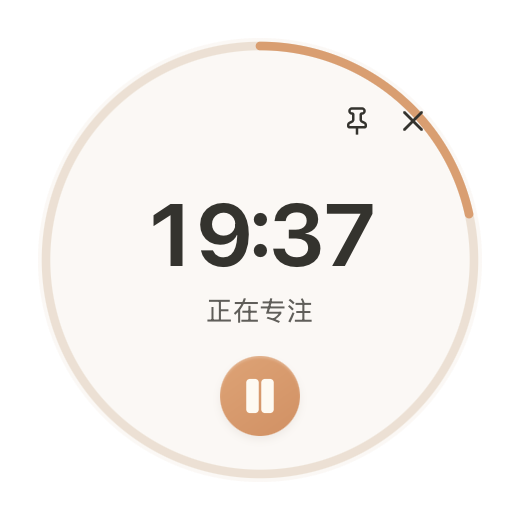
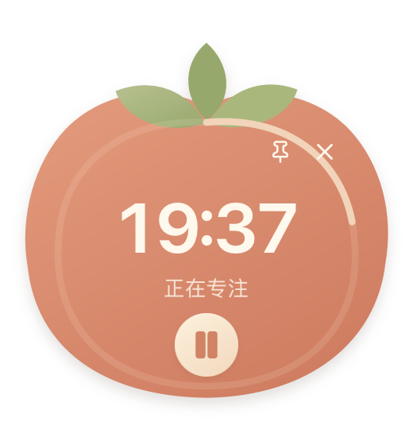
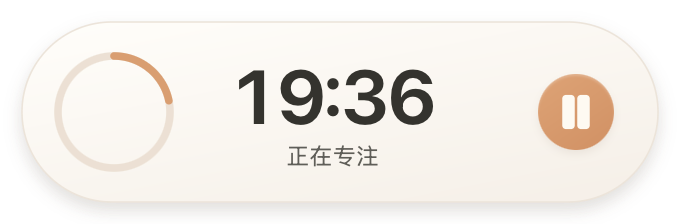
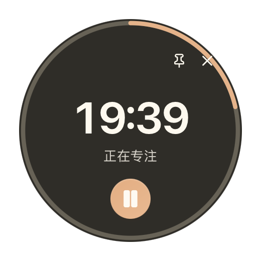
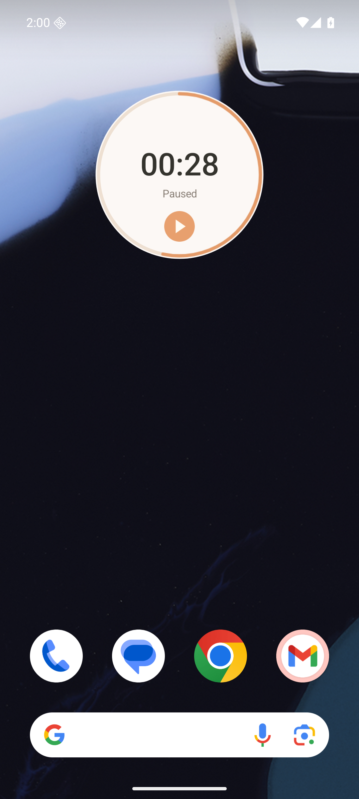
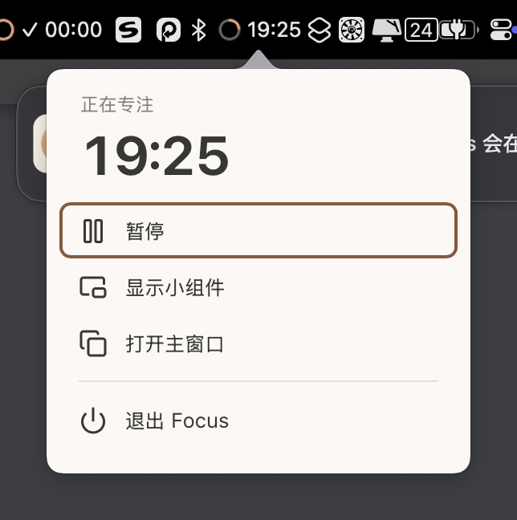

# Focus by Sugar

**ひとつのことに、少しの時間を。** [Sugar](https://sugar.makersns.com) が作る、デスクトップと Android 向けの穏やかな集中タイマーです。

[English](../README.md) · [简体中文](../README.zh-CN.md) · [繁體中文](README.zh-TW.md) · 日本語 · [한국어](README.ko.md)

## 小さな一歩から

読む章、書きたい文章、目の前の小さな仕事をひとつ選びます。Focus はタイトルバーを主画面になじませ、目標入力、フラットで閉じたリング、丸い主要操作を中央に配置しました。数字はカウントダウンし、オレンジの弧は取り組んだ時間に合わせて増えます。4つの点は完了した回数を示します。下部の小さな棚でウィジェットのスタイルと表示を選び、統計や設定もすぐに開けます。

- 主画面のタイトルバーが自然につながり、丸い操作ボタンをフラットなリングの内側に配置。オレンジ色は経過時間を示します。
- 集中・短い休憩・長い休憩。標準は 25 / 5 / 15 分、1〜180 分に変更できます。
- macOS のメニューバーに残り時間を表示。リング・トマト・カプセルのミニタイマーは移動と最前面表示に対応し、メイン画面と同期します。
- Android のホーム画面ウィジェットから、そのまま開始・一時停止・再開できます。
- デスクトップの終了時は一時停止して保存。Android は同じ起動中のプロセス再生成から実行中のタイマーを復元し、端末の再起動後は一時停止します。
- 完了したセッションと途中で終了した集中時間を区別。休憩時間を集中時間に加算しません。
- ライト・ダーク・システム設定に対応。簡体字中国語、繁体字中国語、英語、日本語、韓国語を選べます。
- アカウント、広告、アクセス解析はありません。通知は任意で、次のタイマーは自動的に始まりません。
- 実際の通知許可状態、システム設定への案内、テスト通知、任意のシステム通知音。

| ダークテーマ | 通知設定 |
| --- | --- |
|  |  |

## 3つのかたち、同じタイマー

**リング**は影のないフラットで閉じた形。**トマト**は温かい色と小さな葉。**カプセル**は省スペースです。主画面や設定で切り替えても、進行中の回はリセットされません。数字は残り時間を示し、色のついた弧は経過時間に合わせて増えます。一時停止すると止まり、完了すると満ち、リセットするとゼロに戻ります。トマトは読みやすい淡い色の弧を使います。

| リング | トマト | カプセル |
| --- | --- | --- |
|  |  |  |

## 必要な場所に、残り時間を

macOS / Windows のミニタイマーは軽量なアプリのフローティングウィンドウで、macOS 版は Apple WidgetKit のシステムウィジェットではありません。Android はネイティブのホーム画面 AppWidget を使用します。同一端末の画面は同じタイマーを共有します。デスクトップの時間を押すと主画面が開き、隠しても計時は続きます。毎秒の更新でほかのアプリのフォーカスを奪うこともありません。macOS ではミニタイマーを最前面に固定すると、別のアプリのフルスクリーンスペースでも表示できます。

| ダークのリング | Android ホーム画面ウィジェット |
| --- | --- |
|  |  |

## 必要なときに、お知らせ

完了通知は初期設定でオフです。有効にするか、明示的にテストするときに許可を求めます。設定には実際の許可状態、システム設定へのボタンまたは案内、テスト通知があります。テストでタイマーやセッション記録が変わることはありません。

音はシステム通知の任意項目で、OS が通知と一緒に再生します。完了時は1件の通知を使用し、システムの音量、ミュート、通知を制限するモードに従います。ブラウザープレビューではインストール版の機能であることを明示します。

## ダウンロード

[GitHub Releases](https://github.com/makersns/focus-timer/releases/latest) から macOS ユニバーサル DMG、Windows x64 インストーラー、Linux x64 AppImage / DEB / RPM、Android arm64 の署名済み APK をダウンロードできます。SHA-256 のチェックサムも同梱しています。

初回リリースは Apple の公証と Windows の発行元証明書による署名を行っていません。OS が開発元を確認できない旨を表示する場合があります。Linux のトレイ機能はデスクトップ環境に依存します。

## 記録について

直近 500 件のセッションと、最大 366 日付分の日別合計を端末に保存します。途中終了した集中時間も保存されますが、完了数には含めません。記録を消去しても実行中のタイマーは止まりません。

デスクトップでは操作時と最長 30 秒間隔のチェックポイントで保存します。突然終了した場合は、最後に保存した時点以降の進行が失われる可能性があります。Android はシステムの Chronometer、フォアグラウンドサービス、終了時刻のアラームを使い、起動情報と経過時間を同じ状態ファイルで管理します。記録をサーバーへ送信することはありません。

## 開発

Node.js 24 以降、Rust、[Tauri 2 のプラットフォーム依存環境](https://v2.tauri.app/start/prerequisites/) を用意してください。

~~~bash
git clone https://github.com/makersns/focus-timer.git
cd focus-timer
npm ci
npm run tauri -- dev
~~~

~~~bash
npm test
npm run build
cargo test --locked --manifest-path src-tauri/Cargo.toml
npm run tauri -- build
~~~

構成と翻訳の手順は [Contributing](../CONTRIBUTING.md) にあります。ブラウザーでの UI プレビューは npm run dev で起動できます。トレイ、フローティングウィンドウ、Android ウィジェット、通知はインストール版の機能です。Android の開発と署名方法は [Android ガイド](ANDROID.md) を参照してください。

気に入ったら、Star で応援していただけるとうれしいです。不具合の報告や翻訳の改善も歓迎します。

[MIT ライセンス](../LICENSE) · [作者のサイト](https://sugar.makersns.com) · [更新履歴](../CHANGELOG.md)
