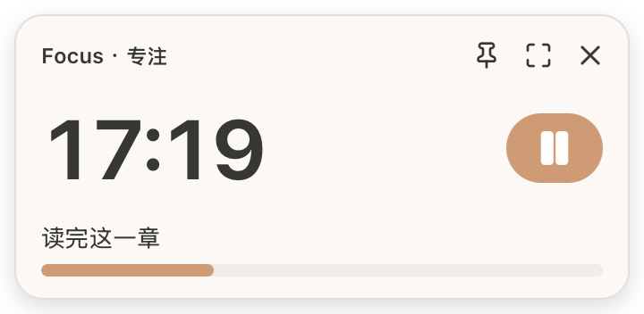

# Focus by Sugar

**잠깐의 시간, 한 가지에 집중하세요.** [Sugar](https://sugar.makersns.com)가 만드는 데스크톱과 Android용 차분한 집중 타이머입니다.

[English](../README.md) · [简体中文](../README.zh-CN.md) · [繁體中文](README.zh-TW.md) · [日本語](README.ja.md) · 한국어

## 작은 일 하나부터

하고 싶은 일 하나와 시간을 정하고 시작하세요. 화면에는 타이머와 다음 동작이 중심에 놓입니다. 언제 쉬고 언제 다음 세션을 시작할지는 직접 선택합니다.

- 집중, 짧은 휴식, 긴 휴식. 기본 25 / 5 / 15분이며 1–180분으로 바꿀 수 있습니다.
- macOS 메뉴 막대에서 남은 시간을 바로 확인하세요. 데스크톱 미니 타이머는 이동 및 항상 위에 표시를 지원하며 메인 창과 동기화됩니다.
- Android 홈 화면 위젯에서 앱을 열지 않고 시작, 일시 정지, 계속하기를 사용할 수 있습니다.
- 데스크톱 앱을 종료하면 일시 정지하고 저장합니다. Android는 같은 부팅 중 프로세스가 다시 만들어져도 현재 타이머를 복원하고, 기기를 재부팅하면 일시 정지 상태로 복원합니다.
- 완료한 세션과 일찍 끝낸 집중 시간을 따로 기록합니다. 휴식은 집중 시간에 더하지 않습니다.
- 밝게, 어둡게, 시스템 설정 및 간체 중국어, 번체 중국어, 영어, 일본어, 한국어를 지원합니다.
- 계정, 광고, 분석 추적이 없습니다. 알림은 선택 사항이며 다음 타이머를 자동으로 시작하지 않습니다.

## 필요한 곳에서 시간을 확인하세요

macOS / Windows에서는 가벼운 플로팅 창을, Android에서는 실제 AppWidget을 사용합니다. 미니 타이머를 숨겨도 시간이 계속 흐르며, 매초 업데이트가 다른 앱의 포커스를 빼앗지 않습니다.

| 데스크톱 미니 타이머 | Android 홈 화면 위젯 |
| --- | --- |
|    |  |

## 다운로드

[GitHub Releases](https://github.com/makersns/focus-timer/releases/latest)에서 macOS 범용 DMG, Windows x64 설치 프로그램, Linux x64 AppImage / DEB / RPM, 서명된 Android arm64 APK와 SHA-256 체크섬을 받을 수 있습니다.

첫 릴리스에는 Apple 공증과 Windows 게시자 인증서 서명이 적용되지 않았습니다. 운영 체제가 확인되지 않은 개발자 안내를 표시할 수 있습니다. Linux 트레이 지원은 데스크톱 환경에 따라 다릅니다.

## 기록과 저장

최근 500개 세션과 최대 366개 날짜의 일별 합계를 기기에 보관합니다. 일찍 끝낸 집중 시간은 저장하지만 완료 횟수에는 포함하지 않습니다. 기록을 지워도 실행 중인 타이머는 계속됩니다.

데스크톱에서는 사용자 동작과 최대 30초 간격의 체크포인트에서 저장합니다. 갑자기 종료되면 마지막 저장 이후의 진행 상황이 사라질 수 있습니다. Android는 시스템 Chronometer, 포그라운드 서비스와 종료 알람을 사용하며, 부팅 정보와 경과 시간을 하나의 상태 파일에 함께 저장합니다. 기록을 서버에 전송하지 않습니다.

## 개발

Node.js 24 이상, Rust, [Tauri 2 플랫폼 필수 환경](https://v2.tauri.app/start/prerequisites/)이 필요합니다.

~~~bash
git clone https://github.com/makersns/focus-timer.git
cd focus-timer
npm ci
npm run tauri -- dev
~~~

~~~bash
npm test
npm run build
cargo test --locked --manifest-path src-tauri/Cargo.toml
npm run tauri -- build
~~~

구조와 번역 안내는 [기여 가이드](../CONTRIBUTING.md)를 참고하세요. 브라우저 UI 미리보기는 npm run dev로 실행합니다. 트레이, 플로팅 창, Android 위젯과 알림은 설치형 앱에서 제공됩니다. Android 개발과 APK 서명은 [Android 안내](ANDROID.md)를 참고하세요.

도움이 되었다면 Star로 응원해 주세요. 문제 제보, 사용 의견, 번역 개선도 환영합니다.

[MIT 라이선스](../LICENSE) · [작가 홈페이지](https://sugar.makersns.com) · [변경 기록](../CHANGELOG.md)
