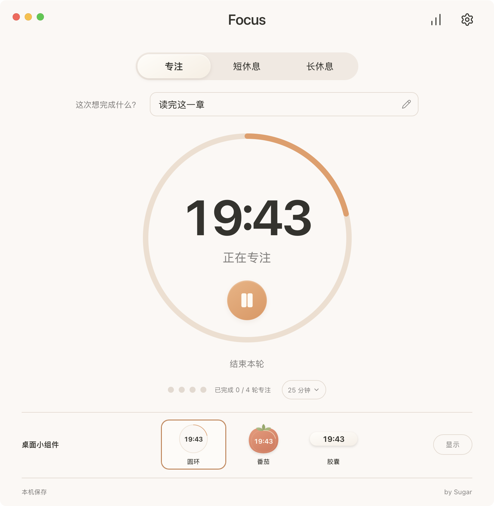
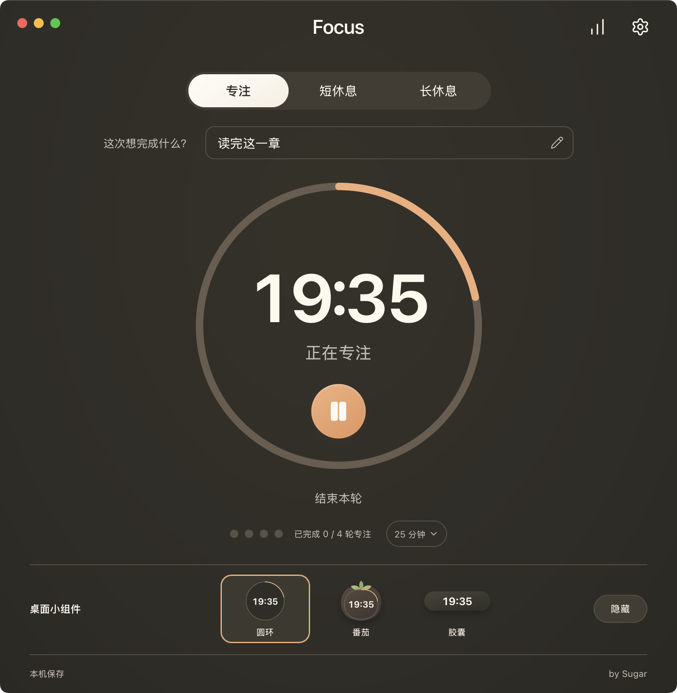
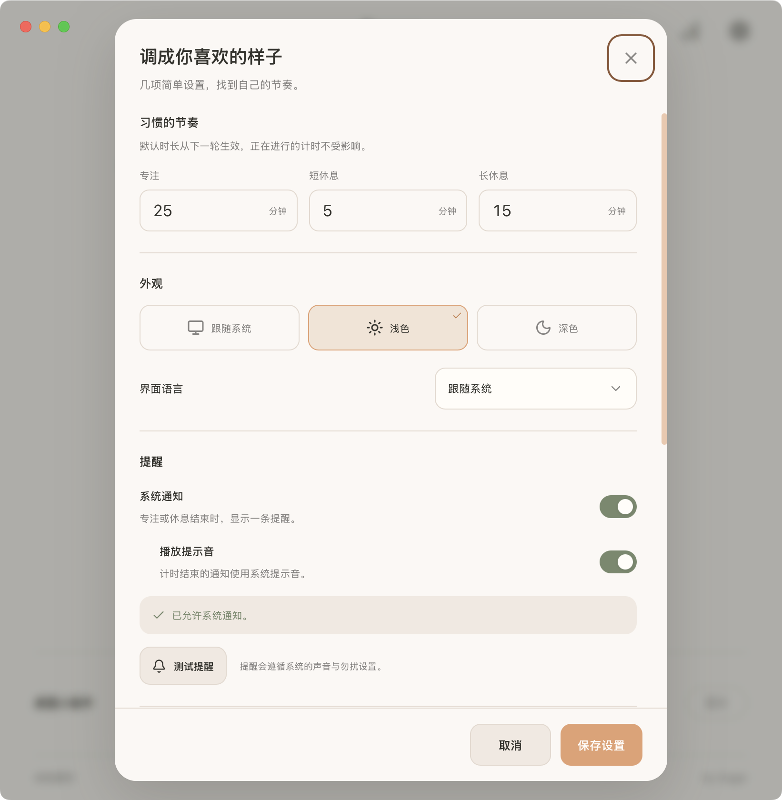
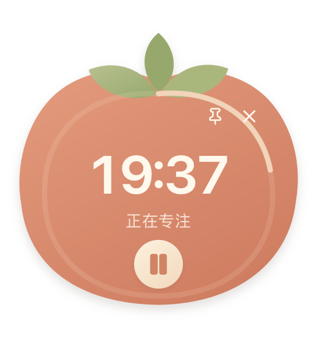
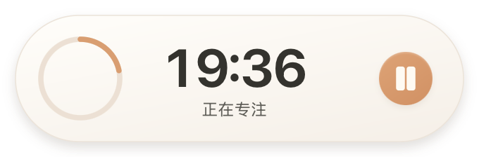
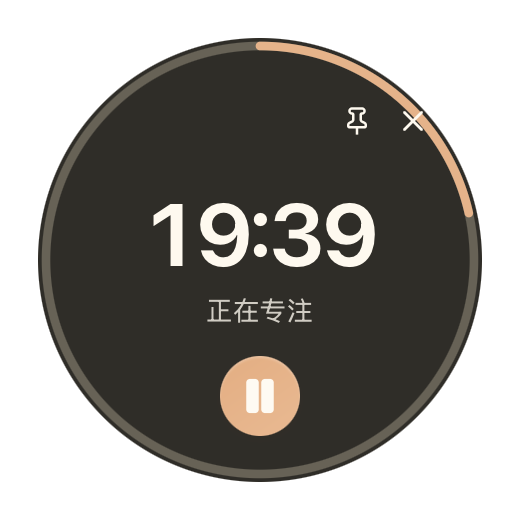
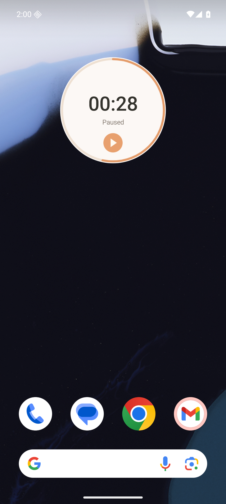
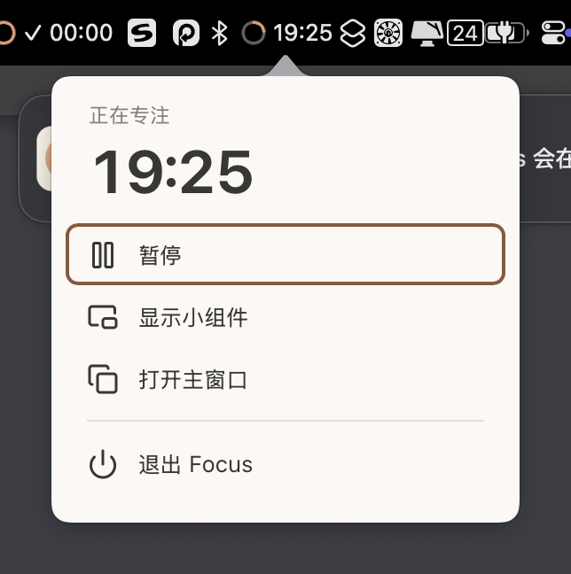

# Focus by Sugar

**잠깐의 시간, 한 가지에 집중하세요.** [Sugar](https://sugar.makersns.com)가 만드는 데스크톱과 Android용 차분한 집중 타이머입니다.

[English](../README.md) · [简体中文](../README.zh-CN.md) · [繁體中文](README.zh-TW.md) · [日本語](README.ja.md) · 한국어

## 작은 일 하나부터

읽을 한 장, 쓸 글, 눈앞의 작은 일 하나를 고르세요. Focus는 제목 표시줄을 메인 화면에 자연스럽게 이어 놓고, 선택 목표와 평면의 닫힌 링, 둥근 기본 동작을 중심에 배치했습니다. 숫자는 카운트다운하고 주황색 호는 집중한 시간에 따라 늘어납니다. 네 개의 점은 실제 완료한 세션을 나타냅니다. 아래의 작은 영역에서 위젯 스타일과 표시를 선택하고 통계와 설정도 바로 열 수 있습니다.

- 자연스럽게 이어지는 제목 표시줄과 평면 링 안의 둥근 버튼. 주황색 진행은 집중한 시간을 나타냅니다.
- 집중, 짧은 휴식, 긴 휴식. 기본 25 / 5 / 15분이며 1–180분으로 바꿀 수 있습니다.
- macOS 메뉴 막대에서 남은 시간을 바로 확인하세요. 링·토마토·캡슐 미니 타이머는 이동과 항상 위에 표시를 지원하며 메인 창과 동기화됩니다.
- Android 홈 화면 위젯에서 앱을 열지 않고 시작, 일시 정지, 계속하기를 사용할 수 있습니다.
- 데스크톱 앱을 종료하면 일시 정지하고 저장합니다. Android는 같은 부팅 중 프로세스가 다시 만들어져도 현재 타이머를 복원하고, 기기를 재부팅하면 일시 정지 상태로 복원합니다.
- 완료한 세션과 일찍 끝낸 집중 시간을 따로 기록합니다. 휴식은 집중 시간에 더하지 않습니다.
- 밝게, 어둡게, 시스템 설정 및 간체 중국어, 번체 중국어, 영어, 일본어, 한국어를 지원합니다.
- 계정, 광고, 분석 추적이 없습니다. 알림은 선택 사항이며 다음 타이머를 자동으로 시작하지 않습니다.
- 실제 알림 권한 상태, 시스템 설정 안내, 테스트 알림과 선택 가능한 시스템 알림음.

| 어두운 테마 | 알림 설정 |
| --- | --- |
|  |  |

## 세 가지 모습, 같은 타이머

**링**은 그림자 없는 평면의 닫힌 모양입니다. **토마토**는 따뜻한 색과 작은 잎을, **캡슐**은 적은 공간에 어울립니다. 메인 창이나 설정에서 바꿔도 진행 중인 타이머는 초기화되지 않습니다. 숫자는 카운트다운하고 색칠된 호는 경과 시간에 따라 늘어납니다. 일시 정지하면 멈추고, 완료하면 가득 차며, 초기화하면 비워집니다. 토마토는 잘 보이는 밝은 색 호를 사용합니다.

| 링 | 토마토 | 캡슐 |
| --- | --- | --- |
|  |  |  |

## 필요한 곳에서 시간을 확인하세요

macOS / Windows의 미니 타이머는 가벼운 앱의 플로팅 창이며 macOS 버전은 Apple WidgetKit 시스템 위젯이 아닙니다. Android에서는 실제 홈 화면 AppWidget을 사용합니다. 같은 기기의 화면은 하나의 타이머를 공유합니다. 데스크톱의 시간을 누르면 메인 창이 열리고, 숨겨도 타이머는 계속됩니다. 매초 업데이트가 다른 앱의 포커스를 빼앗지 않습니다. macOS에서 미니 타이머를 항상 위에 표시하도록 고정하면 다른 앱의 전체 화면 공간 위에서도 시간을 확인할 수 있습니다.

| 어두운 링 | Android 홈 화면 위젯 |
| --- | --- |
|  |  |

## 필요할 때 받는 알림

완료 알림은 기본으로 꺼져 있습니다. 직접 켜거나 테스트할 때 권한을 요청합니다. 설정에서 실제 상태를 확인하고 시스템 설정 버튼이나 안내를 이용할 수 있습니다. 테스트 알림은 현재 타이머나 세션 기록을 바꾸지 않습니다.

소리는 완료 알림의 선택 항목이며 운영 체제가 알림과 함께 재생합니다. 완료 시 알림 한 건을 사용하고 시스템 음량·무음·방해 금지 설정을 따릅니다. 브라우저 미리보기에서는 설치된 앱이 필요한 기능임을 분명히 알려 줍니다.

## 다운로드

[GitHub Releases](https://github.com/makersns/focus-timer/releases/latest)에서 macOS 범용 DMG, Windows x64 설치 프로그램, Linux x64 AppImage / DEB / RPM, 서명된 Android arm64 APK와 SHA-256 체크섬을 받을 수 있습니다.

첫 릴리스에는 Apple 공증과 Windows 게시자 인증서 서명이 적용되지 않았습니다. 운영 체제가 확인되지 않은 개발자 안내를 표시할 수 있습니다. Linux 트레이 지원은 데스크톱 환경에 따라 다릅니다.

## 기록과 저장

최근 500개 세션과 최대 366개 날짜의 일별 합계를 기기에 보관합니다. 일찍 끝낸 집중 시간은 저장하지만 완료 횟수에는 포함하지 않습니다. 기록을 지워도 실행 중인 타이머는 계속됩니다.

데스크톱에서는 사용자 동작과 최대 30초 간격의 체크포인트에서 저장합니다. 갑자기 종료되면 마지막 저장 이후의 진행 상황이 사라질 수 있습니다. Android는 시스템 Chronometer, 포그라운드 서비스와 종료 알람을 사용하며, 부팅 정보와 경과 시간을 하나의 상태 파일에 함께 저장합니다. 기록을 서버에 전송하지 않습니다.

## 개발

Node.js 24 이상, Rust, [Tauri 2 플랫폼 필수 환경](https://v2.tauri.app/start/prerequisites/)이 필요합니다.

~~~bash
git clone https://github.com/makersns/focus-timer.git
cd focus-timer
npm ci
npm run tauri -- dev
~~~

~~~bash
npm test
npm run build
cargo test --locked --manifest-path src-tauri/Cargo.toml
npm run tauri -- build
~~~

구조와 번역 안내는 [기여 가이드](../CONTRIBUTING.md)를 참고하세요. 브라우저 UI 미리보기는 npm run dev로 실행합니다. 트레이, 플로팅 창, Android 위젯과 알림은 설치형 앱에서 제공됩니다. Android 개발과 APK 서명은 [Android 안내](ANDROID.md)를 참고하세요.

도움이 되었다면 Star로 응원해 주세요. 문제 제보, 사용 의견, 번역 개선도 환영합니다.

[MIT 라이선스](../LICENSE) · [작가 홈페이지](https://sugar.makersns.com) · [변경 기록](../CHANGELOG.md)
