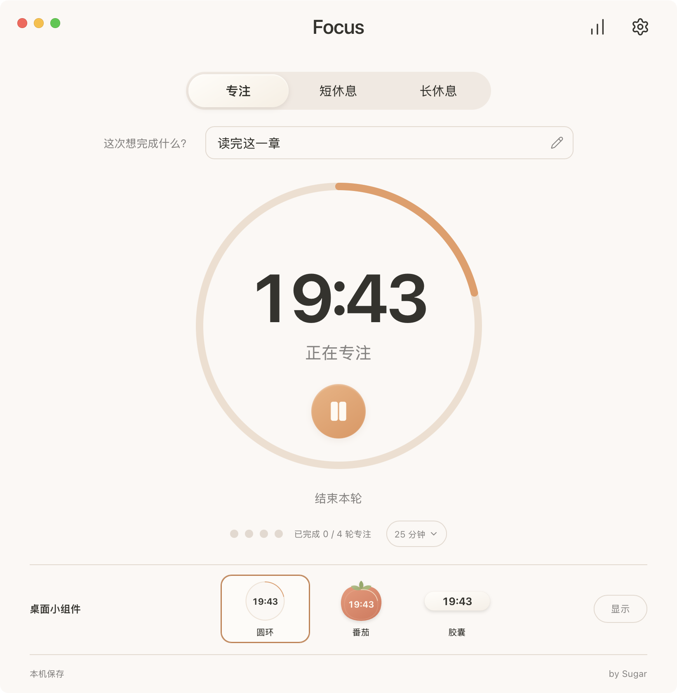
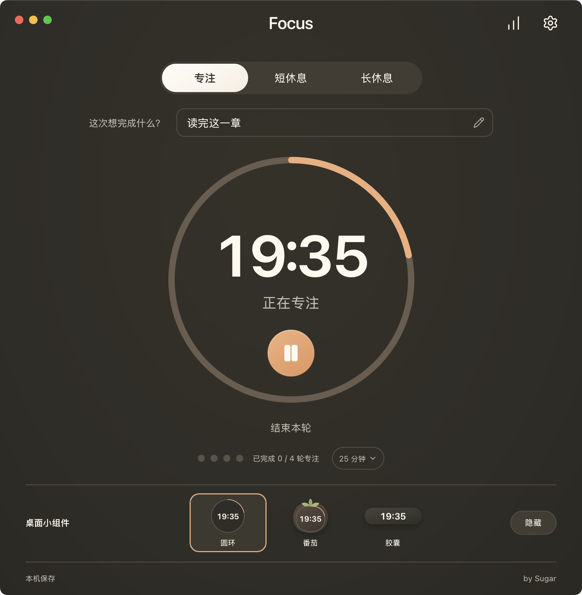
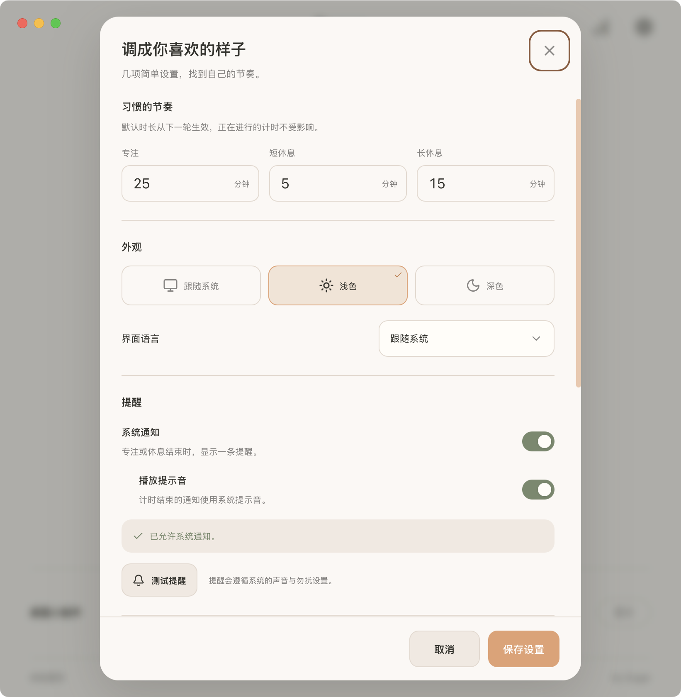
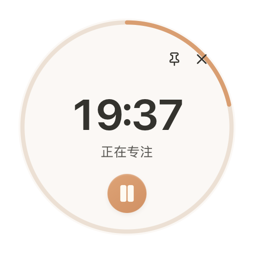
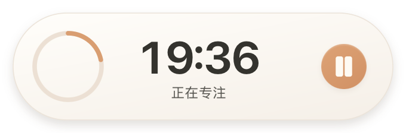
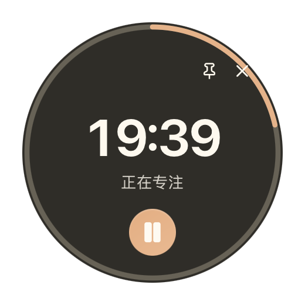
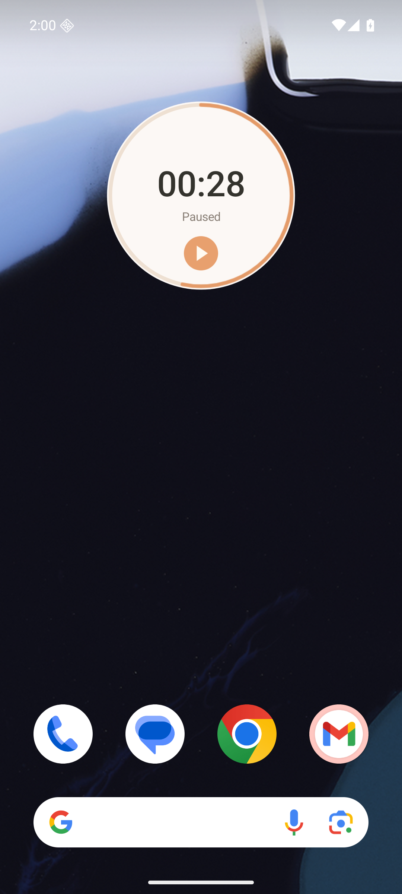
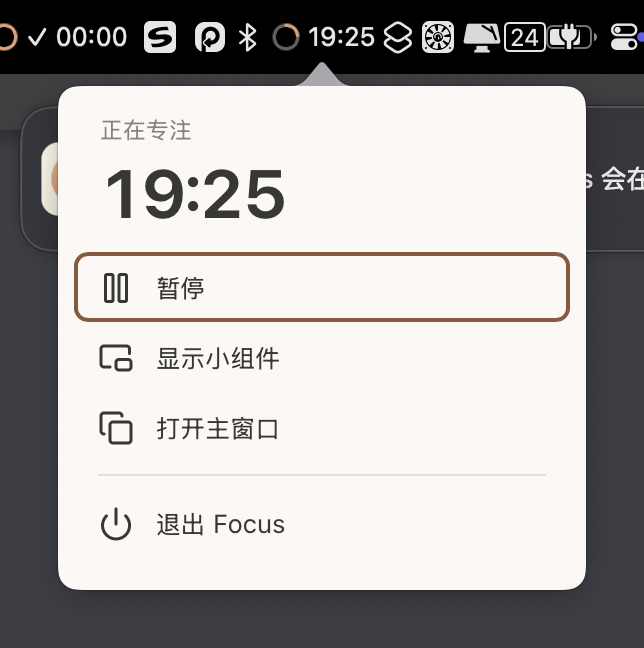

# Focus · 專注計時

**留一點時間，只做好一件事。** 由 [Sugar](https://sugar.makersns.com) 製作的跨平台桌面與 Android 應用。

[English](../README.md) · [简体中文](../README.zh-CN.md) · 繁體中文 · [日本語](README.ja.md) · [한국어](README.ko.md)

## 從一件小事開始

寫作、閱讀，或手邊的一項工作，先選一件想完成的事。Focus 將標題列融入主畫面，把可選目標、平面閉合圓環與圓環內的主要操作排在中心。數字倒數，橙色隨已投入的時間增長；四個圓點對應真實完成輪次。元件樣式與顯示開關放在底部，統計與設定隨時可開啟。

- 融合標題列，主要操作放進平面閉合圓環，橙色顯示已投入的時間。
- 專注、短休息、長休息；預設 25 / 5 / 15 分鐘，可自訂 1–180 分鐘。
- macOS 選單列直接顯示剩餘時間；圓環、番茄、膠囊三款桌面懸浮元件可拖曳、可置頂，與主視窗同步。
- Android 提供真正的主畫面小工具，可直接開始、暫停或繼續。
- 桌面端結束時暫停儲存；Android 同次開機內遭系統回收後可恢復計時，裝置重新開機後暫停。
- 完整完成與提前結束分開記錄，休息時間不計入專注。
- 淺色、深色、跟隨系統，以及簡體中文、繁體中文、英文、日文、韓文。
- 不需帳號，沒有廣告或分析追蹤；通知可自行開啟，下一輪不會自動開始。
- 實際通知權限狀態、系統設定指引、測試提醒與可選系統提示音。

| 深色外觀 | 提醒設定 |
| --- | --- |
|  |  |

## 三種樣式，同一計時

圓環保持平面、閉合的描邊；番茄以暖色與葉片增添輕鬆感；膠囊讓時間少占一點空間。主視窗與設定中的樣式卡片共用同一項偏好，切換不會重置計時。數字持續倒數，橙色進度隨已投入的時間增長；暫停時停住，完成時填滿，重置後歸零。番茄使用對比更清楚的淺色描邊。

| 圓環 | 番茄 | 膠囊 |
| --- | --- | --- |
|  |  |  |

## 隨時看得到

macOS / Windows 的元件是輕量應用程式懸浮視窗，macOS 版不是 Apple WidgetKit 系統小工具；Android 使用原生主畫面 AppWidget。同一裝置上的各個畫面共用同一個計時。點擊桌面元件的時間可開啟主視窗，隱藏不會暫停計時，每秒更新也不會搶走其他應用程式的焦點。在 macOS 中，將小工具置頂後，也能在其他應用程式的全螢幕空間上方查看計時。

| 深色圓環元件 | Android 主畫面小工具 |
| --- | --- |
|  |  |

## 需要時，再提醒

系統完成通知預設關閉，開啟或主動測試時才要求權限。設定會顯示實際狀態，並提供系統設定入口或手動指引。測試提醒可先檢查系統顯示與聲音，不改變目前的計時或完成紀錄。

聲音是完成通知的可選項，由作業系統隨通知播放。提醒遵循系統音量、靜音與勿擾設定，每次結束只使用一則系統通知。瀏覽器預覽會清楚說明這些功能需要安裝應用程式。

## 下載

前往 [GitHub Releases](https://github.com/makersns/focus-timer/releases/latest) 下載 macOS 通用 DMG、Windows x64 安裝程式，Linux x64 AppImage / DEB / RPM，或 Android arm64 已簽署 APK，並核對 SHA-256 校驗值。

首版尚未經 Apple 公證，也沒有 Windows 發行者簽章，系統可能顯示未識別開發者的提示。Linux 系統匣支援取決於桌面環境。

## 本機資料

最多保留最近 500 筆紀錄及 366 個日期的每日彙總。提前結束只記錄已投入的專注時間，不增加完成次數。清除紀錄不會停止目前的計時。

桌面端操作時立即儲存，背景最長每 30 秒儲存一次檢查點；意外終止可能遺失最後一次儲存之後的進度。Android 以系統 Chronometer、前景服務及到期鬧鐘同步主畫面元件，並依開機識別與經過時間安全恢復。資料留在本機，不會上傳至伺服器。

## 開發

需要 Node.js 24+、Rust 與 [Tauri 2 平台依賴](https://v2.tauri.app/start/prerequisites/)。

~~~bash
git clone https://github.com/makersns/focus-timer.git
cd focus-timer
npm ci
npm run tauri -- dev
~~~

~~~bash
npm test
npm run build
cargo test --locked --manifest-path src-tauri/Cargo.toml
npm run tauri -- build
~~~

完整架構、平台建置與翻譯方式請見 [貢獻指南](../CONTRIBUTING.md)。瀏覽器預覽可執行 npm run dev；系統匣、懸浮視窗、Android 小工具與通知需要原生應用程式。Android 開發及 APK 簽署請見 [Android 說明](ANDROID.md)。

如果這個小作品對你有幫助，歡迎給一個 Star，也歡迎提供建議與翻譯改進。

[MIT 授權](../LICENSE) · [作者首頁](https://sugar.makersns.com) · [版本紀錄](../CHANGELOG.md)
